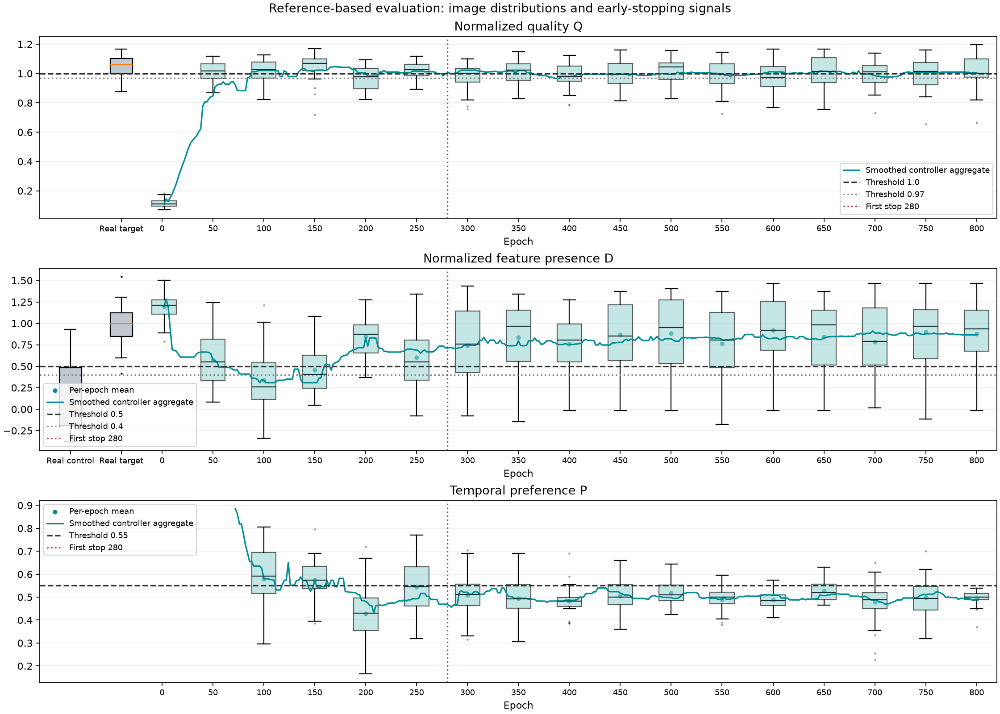
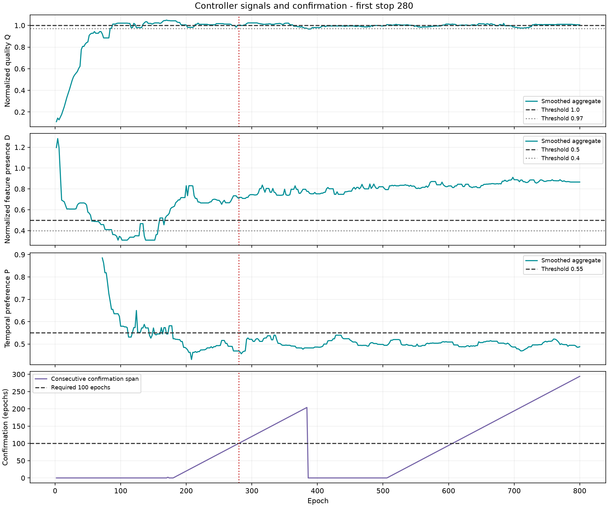
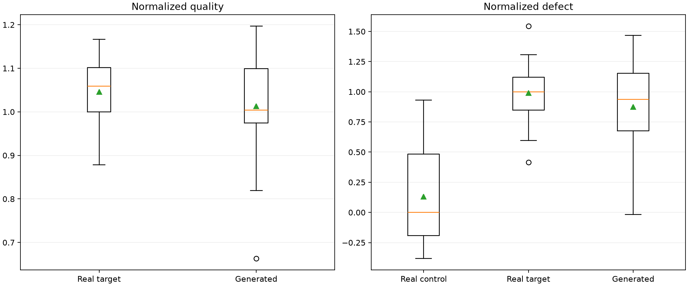

# AI Self Evaluation Module

Evaluate generated images against original-real references and monitor checkpoint quality with a decision API. The trainer supplies images and checkpoints; this package supplies per-image scores, real baselines, temporal comparisons, boxplots and a stopping decision.

**Version 0.2.0.** Model architecture and dataset independent: there are no required angle, class-name or filename conventions. The default prompts address visual realness and visible surface defects. For other features, edit the prompt YAML and build a new baseline. A score is a decision model's judgment under the configured rubric, not verified visual accuracy or downstream utility.

## Example output



Illustrative output layout: image-level boxplots, original-real references, controller curves and thresholds. This is an output example, not a benchmark or an expected stopping epoch. The illustration uses example scores; changing the prompt changes the measurement and requires a new baseline.

The package itself generates this three-panel report. Plot spacing, report formats, resolution, update frequency and all stopping settings are configurable in YAML. Inference produces real-versus-generated boxplots and one score row per input image.

### Controller curves and confirmation



The curves make threshold crossings and confirmation resets visible. The last panel counts elapsed consecutive epochs, rather than the number of evaluations. This output is always generated with every training report.

### Inference comparison



An inference folder produces quality and feature-presence boxplots against the real banks. There is no temporal comparison for a single inference folder. These illustrations show output formats and do not prescribe scores or a stopping epoch for a new dataset.

## Install

Requires Python 3.10 or newer. The evaluator does not depend on PyTorch or a particular generator.

```bash
python -m venv .venv
# Windows: .venv\Scripts\Activate.ps1
# Linux/macOS: source .venv/bin/activate
python -m pip install .
python -m ai_self_evaluation demo --output demo-workspace
```

The demo creates synthetic images and uses a deliberately simple offline mock. It makes zero network calls and tests software behavior, not judge accuracy. Open the report paths printed by the command.

## Configure

Copy the example YAML files into a private working directory. Relative paths resolve from the main YAML file.

```yaml
provider: jev
api_key: ""  # or set TYPESAFE_API_KEY
target_image_dirs: ["dataset/originals/target/train", "dataset/originals/target/validation"]
control_image_dirs: ["dataset/originals/control/train", "dataset/originals/control/validation"]
generated_image_dir: "generated"
output_dir: "outputs/evaluation"
protocol_file: "protocol.yaml"
policy_file: "policy.yaml"
sampling_file: "sampling.yaml"
reporting_file: "reporting.yaml"
```

Each bank pools all listed folders. Supply only original-real images: target examples containing the desired feature, and control examples without it. Keep offline augmentation in the generator's training data, outside these banks. At least six unique originals per bank are required. Exact duplicates are removed from real banks and the banks must be hash-disjoint. Every generated filename is scored, including identical generated contents. Physical-specimen independence and augmentation provenance remain the user's responsibility. Keep a final test set out of calibration banks when it is intended for independent assessment.

| YAML | Responsibility |
| --- | --- |
| `evaluation.example.yaml` | Provider, credentials, folders and component-file paths |
| `protocol.example.yaml` | State, named questions, instructions and criteria |
| `policy.example.yaml` | Normalization, cadence, temporal lag, thresholds, smoothing and patience |
| `selection.example.yaml` | Maturity preference and Q/D weights for checkpoint selection |
| `sampling.example.yaml` | Five references, visits, baseline sample size, panel cap and seed |
| `reporting.example.yaml` | Boxplot spacing, first-epoch inclusion, formats, DPI, render frequency and controller curves |
| `preprocessing.example.yaml` | Shared image conversion and resize |
| `api.example.yaml` | Timeout, maximum payload size and optional HTTP-attempt cap |
| Provider preset / `provider_file` | Endpoint, pinned model, adapter and headers |

Component files are optional: omitted files use installed presets. Inline mappings named `policy`, `selection`, `sampling`, `reporting`, `preprocessing` and `api` override their files. A provider key may be placed directly in a private YAML; `*.local.yaml` is ignored. Never commit that private file. Keys are not serialized into reports or request journals.

## Four evaluations, three signals

1. **Quality:** historical realness question, “How real does candidate C appear, considering the known-real reference images R1-R5?” Five ordered levels: clearly synthetic, mostly synthetic, mixed/uncertain, mostly real, clearly real. Output 0–4.
2. **Presence:** historical visible-defect question, “Does the candidate show a visible defect on the specimen surface?” Five positive and five negative real references. Output 0–1.
3. **Relative forward:** historical neutral question, “Which candidate is more visually similar to the reference images?” Current as A, previous as B, five target references.
4. **Relative reverse:** the same question with candidate positions exchanged.

The first request combines quality, presence and forward comparison. The second contains the reverse comparison. Shared state includes only the candidate; references and the previous image are scoped to the relevant question. Before a matching previous panel exists, only quality and presence are requested. Fixed case identifiers and reference draws are reused across observations. No epoch number or desired stopping epoch is sent to the evaluator.

## Formula and default policy

For each observation, `Q = median(generated quality) / q25(real target quality)`.

`D = (mean(generated presence) - median(real control presence)) / (median(real target presence) - median(real control presence))`.

For each case, average the probability assigned to the current image in the two A/B orders; `P` is the mean over cases. The historical A/B question has no explicit tie option; 0.5 means balanced model preference. It is not an empirically calibrated probability of improvement.

Apply a trailing median over a **20-epoch horizon** to Q, D and P. With audits every 2 epochs, that is 11 observations including endpoints. Become mature at Q ≥ 1.00 and D ≥ 0.50; remain mature at Q ≥ 0.97 and D ≥ 0.40. Lack of marked progress means P ≤ 0.55. Stop after these conditions remain satisfied for **100 consecutive epochs**. Missing cadence resets smoothing and confirmation; a missing temporal score cannot confirm a plateau. There is no minimum target epoch.

These are logical gates, **not a weighted sum**. Q=1 is the chosen real-quality quartile; D=1 is the real-target presence anchor and D=0 the control anchor. D may fall outside [0,1]. A high D alone does not establish realistic defects. Default thresholds are starting settings to assess for the user's own task, not a universal calibration.

Best-checkpoint selection is separate: prioritize mature observations, then minimize `abs(Q-1) + abs(D-1)` using unsmoothed per-epoch aggregates; ties keep the first checkpoint. Selection weights and maturity preference are configurable in `selection.yaml`. This equal-contribution default distance does not enter the stopping condition. An early-stopping epoch is not automatically the best checkpoint.

## Commands

```bash
python -m ai_self_evaluation providers
python -m ai_self_evaluation plan --config evaluation.local.yaml --max-epochs 800
python -m ai_self_evaluation baseline --config evaluation.local.yaml
ai-self-evaluation --config evaluation.local.yaml --images generated --id final
ai-early-stopping --config evaluation.local.yaml --epoch 100 --images checkpoint-panel --checkpoint generator.pt --stop-exit-code
python -m ai_self_evaluation report --config evaluation.local.yaml
```

`plan` is read-only and makes no calls. `report` rebuilds completed outputs without calls. `--stop-exit-code` returns 10 on stop; other successful commands return 0. `--monitor-only` explicitly permits continued observation after a stop decision. A new prompt, model, preprocessing, policy or real bank requires a new output directory; reporting settings can change without reevaluation.

## Attach to a training loop

```python
from ai_self_evaluation import TrainingMonitor

monitor = TrainingMonitor("evaluation.local.yaml")
for epoch in training_epochs:
    train_one_epoch()
    if monitor.due(epoch):
        checkpoint = save_checkpoint(epoch)
        images = generate_fixed_panel(epoch)  # stable relative filenames for the same inputs
        decision = monitor.observe(epoch, images, checkpoint)
        if decision["should_stop"]:
            break
```

Save the checkpoint and a stable generation panel **after** the training epoch. The evaluator does not intercept discriminator batches or start training. Saved panels are preserved to compare the same cases with `t-50`; keep them available. The baseline is created automatically if needed. Prebuilding it before training is recommended to check that the real/control anchors can normalize the measurements.

## Outputs and costs

The output directory contains original-real baseline scores, image scores (QI, D2, both R1 positions and balanced preference), reference manifests, saved checkpoint panels, epoch aggregates, causal decisions, usage counters, boxplot statistics, PNG/PDF/HTML reports and the selected checkpoint. Only outputs, not datasets or API keys, should be shared after review.

Optional `target_max_images` and `control_max_images` caps can limit each baseline bank separately. Default real sample count per bank: `min(N, 256, max(32, ceil(4*sqrt(N))))`; three visits per baseline image, one per generated image, at most 64 checkpoint cases. References remain five per bank per visit. Before temporal comparisons: one request per case/visit; with both orders: two. Inference scores every image in the folder. `plan` gives request-count upper bounds; token billing depends on image preprocessing and provider prices. Completed identical requests are cached. Transport failures are recorded without automatic retry; manually retrying an uncertain request can incur another charge.

Boxplots summarize **individual-image distributions**. For Q their median equals the unsmoothed controller aggregate; D/P use their mean. The colored line adds temporal smoothing, so it need not cross each box's median. Box spacing every 50 epochs is independent of auditing every 2. The inference report shows real and generated distributions, with the control bank added for presence.

## Provider compatibility

Included: JEV (`jev-1.14.0`, image assets and typed score/noul/choice) and offline mock. Other decision models can be configured through a provider YAML **only if they implement the same image-assets and response contract**. Previous incompatible presets are not advertised as supported. See [provider contract](docs/providers.md) and the official [System One API](https://docs.typesafe.ai/api/system-one) and [image documentation](https://docs.typesafe.ai/images). Response types and pinned model identity are checked; a valid response does not establish visual validity.

## Development

```bash
python -m pip install -e .
python -m unittest discover -s tests -v
```

See [protocol](docs/protocol.md), [integration](docs/integration.md), [early stopping](docs/early-stopping.md) and [outputs](docs/outputs.md). MIT license. No model weights, private configuration or dataset is included. Version 0.2 changes the configuration and measurement contract; do not reuse a 0.1 baseline.
